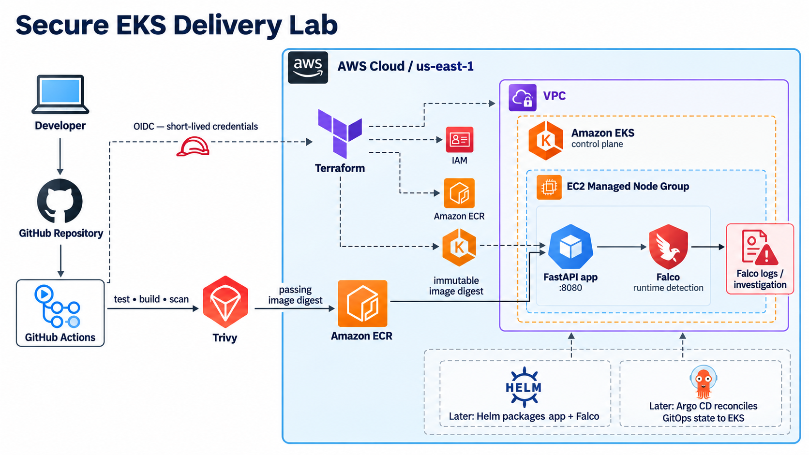

# Secure EKS Delivery Lab

Hands-on DevSecOps portfolio project for delivering a small containerized web application to Amazon EKS securely, detecting vulnerabilities before release, and investigating suspicious runtime behavior.

The emphasis is on learning by building: each stage is implemented, tested, documented, and then reviewed before moving on.

## Goals

- Provision a cost-aware AWS foundation with Terraform.
- Deploy a containerized web application to Amazon EKS using EC2 managed nodes.
- Apply secure Kubernetes workload defaults: non-root execution, readiness probes, resource requests and limits, and least-privilege access.
- Build a CI pipeline with GitHub Actions that tests, builds, scans, and publishes images.
- Scan container images with Trivy, retain the evidence, and document vulnerability triage.
- Deploy immutable image digests from Amazon ECR.
- Detect and investigate suspicious container behavior using Falco.
- Introduce Helm for repeatable packaging and Falco installation.
- Introduce Argo CD for GitOps-based continuous delivery.

## Architecture



```text
Developer change
       |
       v
GitHub Actions: test -> build -> Trivy scan -> security gate
       |
       v
Amazon ECR: versioned, immutable application image
       |
       v
Amazon EKS: application workloads on EC2 managed nodes
       |
       +--> Falco: runtime detection and alert investigation

Later: Helm packages workloads and Falco; Argo CD reconciles declared Git state to EKS.
```

## Security scope

Trivy and Falco serve different purposes:

| Tool  | Purpose                                                                                    |
| ----- | ------------------------------------------------------------------------------------------ |
| Trivy | Finds known vulnerabilities (CVEs) in container images and dependencies before deployment. |
| Falco | Detects suspicious behavior while containers are running.                                  |

Portfolio-lab scan policy: retain Trivy evidence in CI and document material findings. This project intentionally does **not** block delivery on HIGH or CRITICAL findings because its focus is demonstrating the wider delivery, identity, Kubernetes, and runtime-detection lifecycle. A real production service should add a risk-approved vulnerability gate with ownership, remediation deadlines, and exceptions.

## Learning roadmap

### Stage 1 — Infrastructure and application deployment

- [x] Provision and validate the AWS foundation: VPC, private subnets, security groups, ECR, IAM, VPC Flow Logs, remote state, and a GitHub OIDC plan role.
- [ ] Provision EKS and managed nodes. They remain disabled by cost-control feature flags.
- [ ] Use EC2-backed EKS managed nodes to support host-visible Falco runtime detection.
- [x] Build and harden the FastAPI container.
- [x] Deploy and verify it locally on Kind with a Deployment, Service, health probes, ResourceQuota, LimitRange, RBAC baseline, Pod Security Admission, and Cilium NetworkPolicies.
- [x] Verify the workload through `kubectl port-forward` before adding ingress or HTTPS.

### Stage 2 — Secure CI delivery

- [x] Run infrastructure and secret/IaC checks in GitHub Actions.
- [x] Build and scan a `linux/amd64` image with Trivy and retain SARIF evidence as a workflow artifact.
- [x] Authenticate the Terraform plan workflow to AWS through GitHub OIDC; no long-lived AWS key is stored in GitHub.
- [x] Publish a scanned candidate image to ECR and deploy it locally by immutable digest.
- [ ] Automate ECR publication and an EKS deployment only after a dedicated application delivery role and protected environment are configured.

### Stage 3 — Vulnerability remediation exercise

- [ ] Introduce or select an older image with a fixable vulnerability.
- [ ] Capture the failing Trivy report.
- [ ] Update the vulnerable application dependency or base image.
- [ ] Rebuild, rescan, and compare the reports.
- [ ] Record the successful rollout of the patched image.

### Stage 4 — Runtime detection with Helm

- [x] Install Falco using its Helm chart on Kind and generate a controlled shell event.
- [x] Inspect the resulting alert: rule, process, container, pod, and response.
- [ ] Document mitigation and cleanup.

### Stage 5 — GitOps with Argo CD (later)

- [ ] Package the application configuration with Helm.
- [ ] Install Argo CD and connect it to a dedicated GitOps path or repository.
- [ ] Have CI publish artifacts and update declared image-digest state.
- [ ] Let Argo CD reconcile that declared state to EKS.

## Cost controls

This is an intentional, short-lived lab. Resources must not be left running between learning sessions.

- [ ] Set an AWS Budget and billing alerts before creating paid resources.
- [ ] Use explicit Terraform feature flags for billable components, such as EKS, managed node groups, NAT gateways, ingress/load balancers, and runtime tooling.
- [ ] Keep the default lab configuration minimal.
- [ ] Document whether each resource is charged while it exists or only while it is used.
- [ ] Use a teardown checklist after every lab session and verify the AWS console is clear of remaining billable resources.

> Scaling application workloads down does not make an EKS cluster free. EKS control-plane charges and resources such as NAT gateways, load balancers, public IPv4 addresses, EBS volumes, and logs may continue to incur cost while they exist.

## Remediation model

| Vulnerability location         | Expected remediation                                               |
| ------------------------------ | ------------------------------------------------------------------ |
| Application dependency         | Update the dependency and lockfile; test, rebuild, and rescan.     |
| Container OS package           | Update the base image or package installation; rebuild and rescan. |
| EKS worker-node OS             | Update the managed node group AMI and roll nodes safely.           |
| Kubernetes component or add-on | Upgrade the component and verify version compatibility.            |

Application containers are rebuilt and replaced; running pods are never manually patched.

## Evidence to collect

The finished project will demonstrate two independent security outcomes:

1. **Vulnerability remediation:** failed scan -> dependency or base-image update -> passing scan -> successful rollout.
2. **Runtime detection:** controlled suspicious activity -> Falco alert -> investigation -> mitigation.

Keep sanitized screenshots, workflow logs, scan reports, deployment evidence, Falco events, and teardown confirmation. Never commit AWS credentials, kubeconfig files, Terraform state, or sensitive account information.

## Planned repository structure

```text
.
├── app/                 # Application source and tests
├── infra/               # Terraform infrastructure
├── k8s/                 # Raw Kubernetes manifests during early stages
├── helm/                # Helm charts and values (introduced later)
├── gitops/              # Argo CD application definitions (introduced later)
├── docs/                # Architecture, decisions, evidence, and runbooks
└── .github/workflows/   # CI workflows
```

## Current status — 2026-10-27

The project has a working local Kubernetes security baseline and a partially applied, cost-controlled AWS foundation. VPC, ECR, IAM, customer-managed KMS keys, VPC Flow Logs, remote Terraform state, and the GitHub OIDC plan identity exist. EKS, EC2 node groups, NAT Gateway, interface endpoints, ingress, and public application exposure remain disabled.

The active CI path is split deliberately:

- **Pull request validation:** formatting, Terraform validation, TFLint, Checkov (with three documented KMS-policy model exclusions), and Gitleaks.
- **Terraform deployment:** manually dispatched, OIDC-authenticated, remote-state **plan only**; apply is intentionally disabled.
- **Container delivery:** a defined gated workflow runs quality checks, Gitleaks, `linux/amd64` build, Trivy SARIF evidence, a CycloneDX SBOM, and—after protected-environment approval—ECR publication by immutable tags. The publisher role/environment still need to be applied and configured.

Local pre-commit checks, the GitHub PR workflow, the OIDC Terraform plan workflow, and the container evidence workflow have all been validated. See [the task backlog](docs/tasks.md) for remaining platform work.

## Task backlog

Track implementation and evidence in the [project task backlog](docs/tasks.md).

## Design documentation

- [Architecture](docs/architecture.md)
- [Infrastructure design guide](docs/infrastructure-design.md)
- [Design decisions](docs/design-decisions.md)
- [Threat model](docs/threat-model.md)
- [Security controls: Trivy and Falco](docs/security-controls.md)
- [Cost controls and teardown](docs/cost-controls.md)

## Local application workflow

The sample FastAPI service is intentionally small: it exposes service metadata, liveness and readiness endpoints, and an in-memory task API. It is a disposable workload used to practice platform delivery and security controls, not a production application.

```bash
python -m venv .venv
# Windows PowerShell: .venv\\Scripts\\Activate.ps1
source .venv/bin/activate
pip install -e ".[dev]"
pytest
uvicorn app.main:app --host 127.0.0.1 --port 8080
```

Useful endpoints: `/`, `/health/live`, `/health/ready`, and `/docs`.

Build and run the container locally:

```bash
docker build -t secure-eks-delivery:local .
docker run --rm -p 8080:8080 secure-eks-delivery:local
```

The Dockerfile runs as UID `10001`, rather than root. Kubernetes will later reinforce this with a security context and other workload restrictions.
