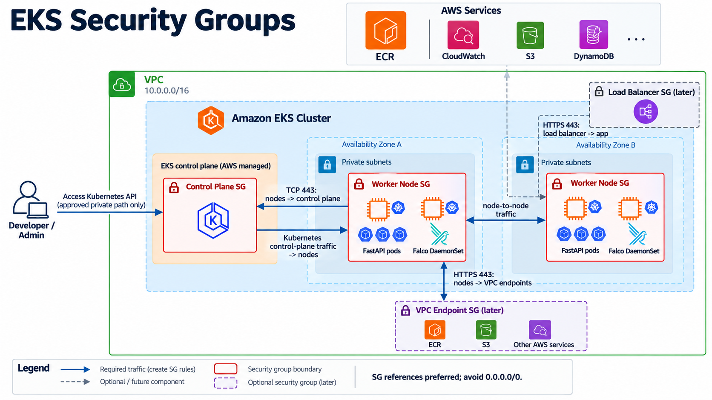

# Building a Secure EKS Delivery Lab

I’m building a small DevSecOps project for how a small application moves from source code to a monitored workload on EKS.

The project is based of course, on Terraform provisions the AWS foundation, with GitHub Actions testing and scanning the image, Trivy will block vulnerable builds, and Falco will provide runtime detection once the application is running on EKS.

Helm and Argo CD will be introduced later, after the manual deployment path is done. Alternatively, I'm also planning a KIND (k8s in docker) deployment as a second option :)


The security-group relationships are documented separately in this companion diagram:



## What is already in place as of today

- A cost-conscious VPC foundation with private subnets across two Availability Zones.
- Security groups for the EKS control plane and worker nodes.
- A private, immutable ECR repository with scan-on-push and lifecycle cleanup.
- IAM roles for the EKS control plane and managed node group.
- Terraform switches that keep EKS, node groups, NAT, ingress, and private endpoints disabled until they are intentionally needed.

## The security focus

As I will be preparing to take CKS somewhere in the near future, I wanted to get into the intrincacies of DevSecOps with a bit more of Hands-On today.

The planned delivery workflow will scan the container image with Trivy before publishing it to ECR. Deployments will use immutable image digests rather than mutable tags. After the workload is stable, Falco will monitor runtime behavior and provide evidence for controlled security investigations.

The initial network egress policy is deliberately temporary and unrestricted so the platform can be validated. A later hardening phase will restrict egress through NAT or VPC endpoints. The EKS API currently uses private access plus a public endpoint restricted to the administrator’s IP; the target state is a fully private endpoint accessed through an SSM-managed administration host.

## Designing Infra by Layers

The project so far is being built in stages:

```text
Terraform foundation
  -> VPC, IAM roles, neccesary bootstrap and infra, etc
  -> EKS and managed nodes
  -> API deployment (made with fastAPI/Python)
  -> Helm packaging
  -> Trivy delivery gates
  -> Falco runtime detection
  -> Argo CD GitOps reconciliation as the cherry on top
```

Before incurring EKS costs, the same application and Helm chart will also be tested on local Kubernetes. This keeps the workload portable while isolating AWS-specific components such as ECR, IAM, the AWS Load Balancer Controller, and the VPC CNI.

The goal is not just to deploy an application, but to ensure each security and infrastructure decision well enough to review, harden, and eventually operate it responsibly.

## Useful references

- [Amazon EKS Kubernetes version lifecycle](https://docs.aws.amazon.com/eks/latest/userguide/kubernetes-versions.html)
- [Amazon EKS cluster networking](https://docs.aws.amazon.com/eks/latest/userguide/cluster-network.html)
- [Amazon EKS IAM roles](https://docs.aws.amazon.com/eks/latest/userguide/service_IAM_role.html)
- [Terraform AWS provider: `aws_eks_cluster`](https://registry.terraform.io/providers/hashicorp/aws/latest/docs/resources/eks_cluster)
- [Terraform AWS provider: `aws_eks_node_group`](https://registry.terraform.io/providers/hashicorp/aws/latest/docs/resources/eks_node_group)
- [Trivy documentation](https://trivy.dev/latest/)
- [Falco documentation](https://falco.org/docs/)
