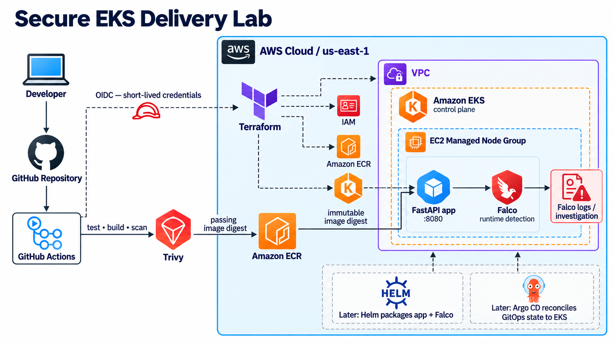

# Secure EKS Delivery Lab — Update #2: From AWS Design to a Secured Local Cluster

This update covers the point where the project stopped being only an AWS diagram and became something I could actually test locally.

The goal is still the same: build a small FastAPI service, deliver it securely to Amazon EKS, and use the project to practise Terraform, container security, Kubernetes security, vulnerability management, and runtime detection. The important constraint is cost: AWS infrastructure is defined in Terraform, but EKS has **not** been applied while I validate the workload locally first.



## AWS infrastructure: designed in layers, intentionally not running

I completed the Terraform foundation as a set of independently understandable layers rather than treating EKS as one large resource:

- Remote Terraform state with an S3 backend.
- A VPC with private subnets across two Availability Zones, route tables, Kubernetes discovery tags, and outputs.
- Separate security groups for the EKS control plane, worker nodes, and VPC interface endpoints.
- An immutable Amazon ECR repository with scan-on-push enabled.
- IAM roles for the EKS control plane and managed worker nodes.
- An EKS control-plane definition, managed node group, and a custom launch template that explicitly attaches the worker-node security group and requires IMDSv2.
- Feature flags for potentially billable services, including EKS, node groups, and private endpoints.

The private-node egress design is based on VPC endpoints rather than a NAT Gateway. The intended endpoints are S3, ECR API, ECR Docker, STS, and EC2. This minimizes unnecessary internet paths and avoids a permanently billed NAT Gateway for a learning lab.

None of those resources have been applied yet. That is deliberate: an EKS control plane has an hourly cost, and I want the application and its Kubernetes controls to be proven locally first.

## A local Kubernetes security baseline

For local testing, I created a kind cluster running Kubernetes `v1.36.1` with one control-plane node and two workers. Cilium provides the CNI and enforces the NetworkPolicies used in this lab.

The FastAPI workload is deployed into a dedicated `secure-eks-delivery` namespace with the Kubernetes Restricted Pod Security Admission profile enabled. The deployment uses:

- A dedicated ServiceAccount with automatic token mounting disabled.
- A non-root process running as UID/GID `10001`.
- `allowPrivilegeEscalation: false`.
- All Linux capabilities dropped.
- `RuntimeDefault` seccomp.
- A read-only root filesystem.
- CPU and memory requests and limits.
- Startup, readiness, and liveness probes against the FastAPI health endpoints.

That configuration is already proving useful. An ad-hoc `kubectl run` test pod was rejected because it did not meet the Restricted Pod Security requirements. The corrected test manifest had to explicitly run as a known non-root UID, drop capabilities, disable privilege escalation, and select a seccomp profile.

## NetworkPolicies: proving both deny and allow paths

The namespace starts with default-deny ingress and egress policies. I then added narrowly scoped exceptions for:

- DNS access from the FastAPI pod to CoreDNS on TCP/UDP 53.
- Ingress to the API on TCP `8080` only from a same-namespace pod labelled `access=api-client`.
- Matching egress from that labelled client to the FastAPI pod.

The useful part was testing the policy, not just applying YAML:

```text
Unlabelled test pod -> FastAPI service:8080 = denied (connection timeout)
Labelled test pod   -> FastAPI service:8080 = allowed (200 /health/ready)
```

This also highlighted a limitation worth remembering: a Kubernetes label is not an identity boundary by itself. A future RBAC and admission-policy exercise will prevent arbitrary workloads from assigning themselves the `access=api-client` label.

## Container and dependency hardening

The Dockerfile now has separate builder and runtime stages. The runtime container uses the same non-root UID as the Kubernetes manifest and carries the application source plus the virtual environment used to run Uvicorn. Removing unnecessary package-management tooling from the final image is a documented follow-up.

I also started a reproducible dependency workflow:

- The Python base image is pinned by SHA-256 digest instead of relying on a mutable tag.
- `requirements.lock` is generated with `pip-compile`, includes transitive dependencies, and records hashes.
- The image build uses `pip install --require-hashes -r requirements.lock`.
- `.dockerignore` allows only the required application files and dependency metadata into the build context.

Trivy is now installed locally and the first scan of the selected Python base image found six `pip` findings: five Medium and one Low, with no High or Critical findings. This is being recorded as a baseline rather than ignored. Five findings have an available fixed version; one currently has no reported fix. Before changing the pinned base image, I will finish the reproducible Docker build, scan the complete application image, then test a newer candidate base-image digest and compare the reports.

## What is next

The next work is intentionally ordered:

```text
Verify the locked Docker build and application health
  -> scan the completed application image with Trivy
  -> investigate and remediate a finding
  -> add CI checks: Gitleaks, Checkov, and Trivy
  -> configure GitHub Actions OIDC with least-privilege AWS access
  -> create the EKS image overlay using an ECR digest
  -> package the workload with Helm
  -> add Falco and run controlled runtime-detection exercises
  -> introduce Argo CD after the manual Helm path is understood
```

The project is no longer only about getting an API onto Kubernetes. It is becoming a record of why each control exists, how it was tested, and what still needs to be hardened before anything is considered production-ready.

## References

- [Kubernetes Pod Security Standards](https://kubernetes.io/docs/concepts/security/pod-security-standards/)
- [Kubernetes NetworkPolicies](https://kubernetes.io/docs/concepts/services-networking/network-policies/)
- [kind documentation](https://kind.sigs.k8s.io/)
- [Cilium documentation](https://docs.cilium.io/)
- [Trivy documentation](https://trivy.dev/)
- [Amazon EKS best practices](https://aws.github.io/aws-eks-best-practices/)
- [Terraform AWS provider: EKS cluster](https://registry.terraform.io/providers/hashicorp/aws/latest/docs/resources/eks_cluster)
